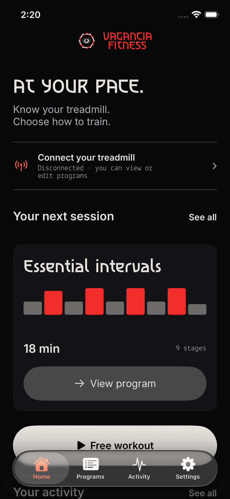
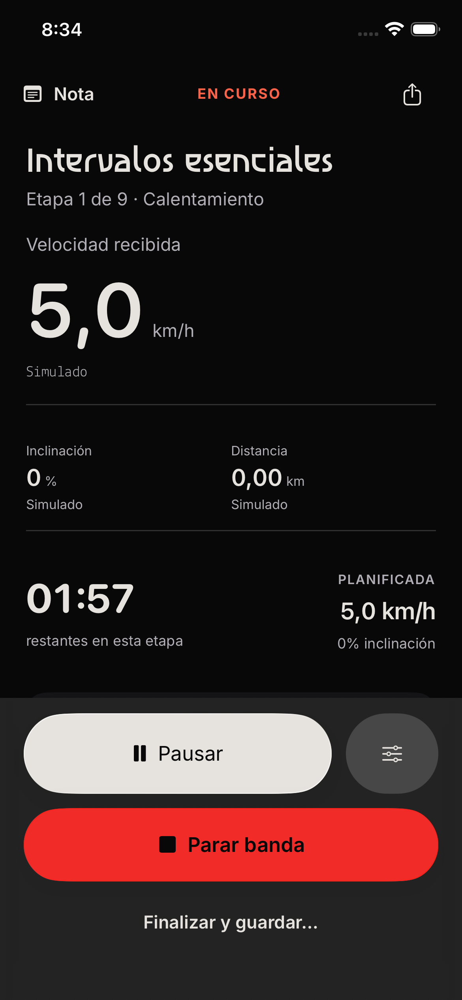
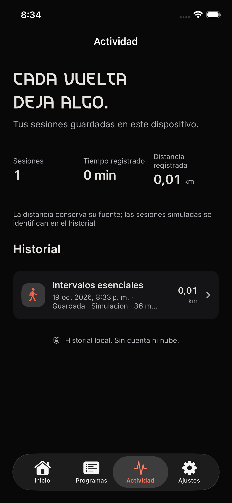
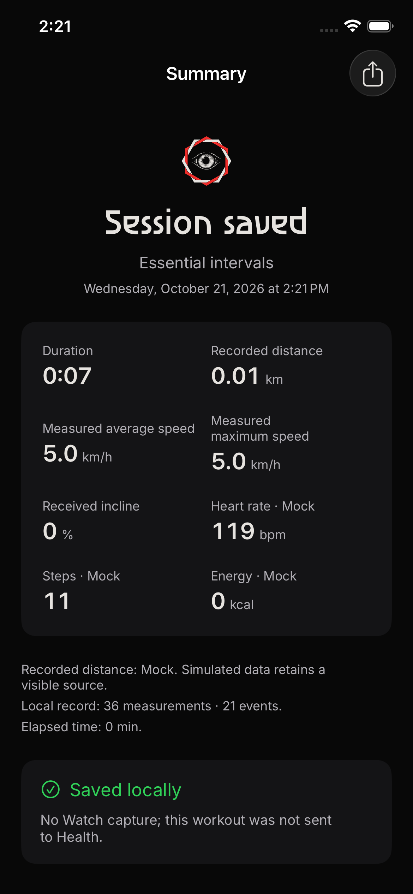
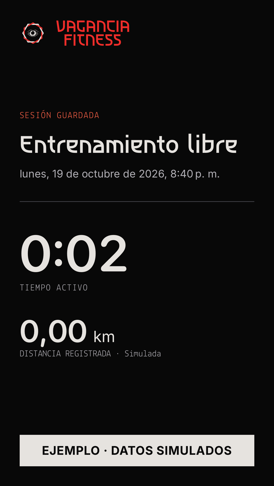
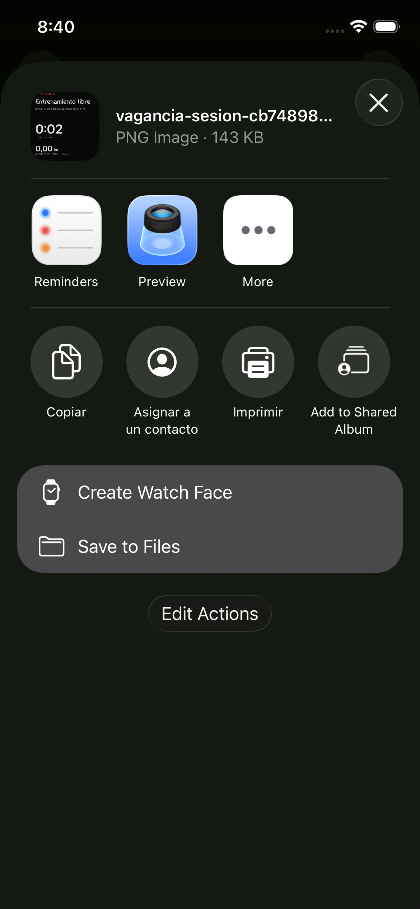

# VAGANCIA FITNESS

A personal treadmill workout project for iPhone and Apple Watch, built with Swift, SwiftUI, CoreBluetooth, and HealthKit.

## Why I built it

I'm building Vagancia Fitness around my own treadmill workouts. I wanted an app where I could record sessions, keep my workout history locally, and bring in workout and health data from Apple Watch.

The project includes a workout app, an Apple Watch companion, and a separate Bluetooth diagnostic app. Keeping the diagnostic tools separate gives me room to investigate what the treadmill reports while developing the workout experience. The Apple apps share a local FitnessKit package.

The app supports Spanish and English and works without an account or project backend. I'm sharing the source so others can inspect it and build it locally.

The app inspects Bluetooth services, decodes FTMS telemetry, records workouts and exports evidence locally. Movement commands require an explicit operator action. Bluetooth stop is not an emergency stop. [Product scope](PRODUCT.md) defines supported features and evidence limits.

Distribution is source-only. Build the apps locally using the [Apple development guide](docs/development/apple.md); use the repository's GitHub Issues for reports and questions.

## Native app preview

<table>
  <tr>
    <th>Home</th><th>Workout</th><th>History</th>
  </tr>
  <tr>
    <td></td>
    <td></td>
    <td></td>
  </tr>
</table>

Open the full-size captures: [Home](docs/images/app-home.png), [Workout](docs/images/app-workout.png), [History](docs/images/app-history.png).

### Results and sharing

<table>
  <tr>
    <th>Saved results</th><th>Exported image</th><th>iOS share sheet</th>
  </tr>
  <tr>
    <td></td>
    <td></td>
    <td></td>
  </tr>
</table>

Open full size: [Results](docs/images/app-results.png), [Exported image](docs/images/app-share-card.png), [Share sheet](docs/images/app-share-sheet.png).

The middle image is the actual PNG that the native app exports through the iOS share sheet. The results screen shows a program workout; the shared image and share sheet show a separate free-workout test session, so their values differ. All measurements are synthetic. System share actions reflect the simulator's installed apps and language settings.

These are native SwiftUI simulator captures in English from isolated UI-test scenarios, with synthetic data. They do not establish hardware compatibility or sensor accuracy. [Try the demonstration walkthrough](docs/guides/using-the-app.md#try-a-workout-without-hardware); [capture sources](docs/images/README.md) identify the reproducible test flows and the separate Spanish-language Debug reference.

## Start here

- [Use the app](docs/guides/using-the-app.md): connect a treadmill, prepare Watch capture, train and export.
- [Develop on Apple platforms](docs/development/apple.md): tools, project generation, builds and tests.
- [Understand the architecture](docs/architecture.md): app boundaries, runtime behavior and rationale.
- [Browse the documentation](docs/README.md): current guides, contracts and policies.

Generate with `./apple/scripts/generate-project`, then open [`apple/VaganciaFitness.xcodeproj`](apple/VaganciaFitness.xcodeproj). Choose `VaganciaFitness`, `VaganciaFitnessDebug` or `VaganciaFitnessWatch`. The [project specification](apple/project.yml) defines build settings; [local configuration](docs/development/local-configuration.md) explains optional signing setup.

For documentation and repository tooling, `./scripts/check-repository` runs on macOS or Linux with Python 3.11+ and requires no Xcode. The [Apple setup guide](docs/development/apple.md#prepare-a-development-machine) covers the native toolchain and simulators.

The source targets iOS/watchOS 26 and uses Swift 6, SwiftUI, CoreBluetooth, HealthKit and SQLite. Android has no app, build, runtime or CI support in this repository; see [platform scope](docs/compatibility/platforms.md). [Shared contracts and vectors](shared/README.md) remain independent of Apple frameworks.

## Contribute and share

See [CONTRIBUTING.md](CONTRIBUTING.md), [privacy](PRIVACY.md) and [security reporting](SECURITY.md). Documentation and code comments use English; the app interface supports Spanish and English. Private captures, diagnostic originals, signing configuration and local verification evidence remain outside public source.

## License

Project code uses [MIT](LICENSE). Fonts retain OFL, the project brand has separate trademark conditions, and FitShow screenshots remain private. See [third-party notices](THIRD_PARTY_NOTICES.md).
